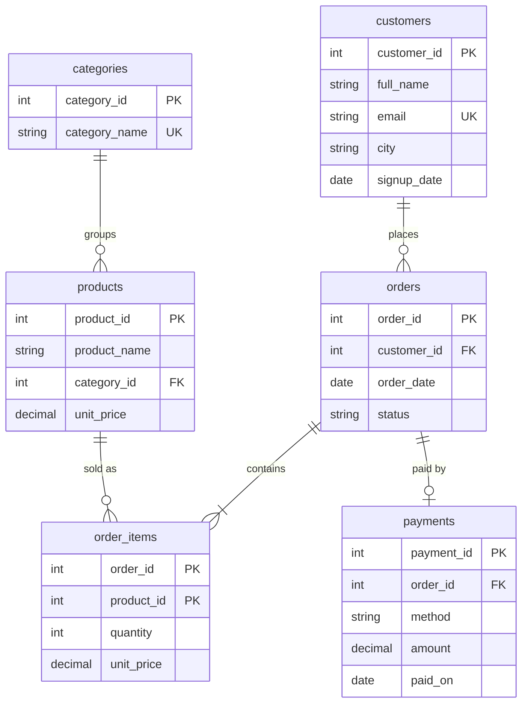

# E-commerce Analytics Database (SQL)

A complete SQL project: a normalized e-commerce database (customers, products, orders, payments) plus **28 analytics queries** that answer real business questions - revenue trends, best sellers, customer segmentation, cohort retention and data-quality checks.

Built for **MySQL 8.0+**. The SQL is deliberately portable, so it also runs unchanged on SQLite 3.25+ (that is how the automated test works).

## What this project demonstrates

| Area | Where |
|---|---|
| Schema design: PKs, FKs, `CHECK`, `UNIQUE`, indexes | `schema.sql` |
| Views for reusable business logic (`v_order_totals`, `v_revenue_orders`) | `schema.sql` |
| `JOIN`s (inner, left, self, anti-join), `GROUP BY`, `HAVING` | queries 01-03 |
| CTEs and subqueries | queries 02-04 |
| Window functions: `RANK`, `DENSE_RANK`, `ROW_NUMBER`, `NTILE`, `LAG`, running `SUM() OVER`, moving average | queries 02-04 |
| Business analysis: RFM segmentation, MoM growth, cohorts, market basket, return rate | queries 03-04 |
| Data validation with "expect 0 rows" checks | query 05 |

## Database design



**Sample data:** 150 customers, 24 products in 6 categories, 399 orders (Jan 2025 - Sep 2026), 877 order lines, 368 payments. Generated with a fixed seed by `tools/generate_data.py`, so results are reproducible.

**Business rule:** "revenue" means orders with status `DELIVERED` or `SHIPPED`. Cancelled and returned orders are excluded (encoded once, in the `v_revenue_orders` view).

## How to run

### MySQL

```bash
mysql -u root -p -e "CREATE DATABASE ecommerce; USE ecommerce; SOURCE schema.sql; SOURCE data.sql;"
mysql -u root -p ecommerce < queries/01_business_overview.sql
```

Or open the files in MySQL Workbench / DBeaver and run them in order: `schema.sql`, `data.sql`, then any file in `queries/`.

### No database installed? Use the test runner (Python 3 only)

```bash
python3 tests/run_all.py          # runs all 28 queries, shows the first rows of each
python3 tests/run_all.py --full   # shows every row
```

It loads the schema and data into an in-memory SQLite database, runs every query, and fails if any query errors or if a data-quality check returns rows.

## Project structure

```
sql-ecommerce-analytics/
├── schema.sql                         tables, indexes, views
├── data.sql                           sample data (generated)
├── queries/
│   ├── 01_business_overview.sql       KPIs, status mix, city and payment analysis
│   ├── 02_products_and_categories.sql top products, category share, basket analysis
│   ├── 03_customers.sql               lifetime value, RFM segments, repeat buyers
│   ├── 04_time_trends.sql             MoM growth, running totals, cohorts
│   └── 05_data_quality.sql            integrity checks (all expect 0 rows)
├── tools/generate_data.py             reproducible data generator
└── tests/run_all.py                   automated smoke test
```

## Sample findings (from the included data)

- **351 revenue orders** from **129 paying customers**, total revenue **Rs 27.88 lakh**, average order value **Rs 7,944**.
- **Home & Kitchen (36.9%)** and **Electronics (33.6%)** generate about 70% of revenue; the Air Fryer alone brings in Rs 4.68 lakh.
- **Mumbai** is the top city by revenue (Rs 5.56 lakh), followed by Delhi and Bengaluru.
- About **37% of customers order only once** and 25% are loyal (4+ orders), which is the retention opportunity the RFM query is meant to surface.
- Two products (`Cotton T-Shirt`, `Sunscreen SPF50`) have **never sold**, and 12 customers signed up but never ordered.

## Interview talking points

- *Why a view for revenue?* One definition of "revenue" used everywhere, so a rule change is a one-line fix.
- *Why `NTILE` for RFM?* It scores customers relative to each other, so segments adapt as the data grows instead of relying on hard-coded thresholds.
- *Why `unit_price` in both `products` and `order_items`?* Prices change and discounts happen; the order line stores what the customer actually paid, so history stays correct.
- *Why index `orders(customer_id)` and `orders(order_date)`?* They are the join and filter columns in almost every report.
- *Anti-join:* `LEFT JOIN ... WHERE x IS NULL` finds rows with no match (customers with no orders, products never sold).

## Ideas to extend it

- Add a `returns` table with refund amounts and reasons.
- Write a stored procedure `sp_monthly_report(year, month)`.
- Add a trigger that keeps a `customer_lifetime_value` summary table updated.
- Connect Power BI or Metabase to the database and build a dashboard from the queries.
